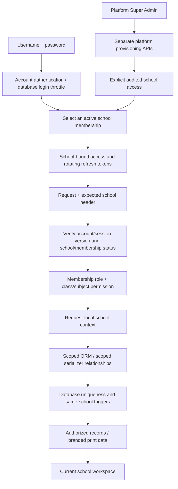

# School workspaces: architecture, operations and verification

## Architecture

React/Vite remains in `frontend/`; Django/DRF remains in `backend/`. Existing endpoint names, academic records, financial records and account passwords are preserved. The UI now uses small reusable components and focused task pages instead of the previous single large component.

One application and one database support independent schools. A shared schema is appropriate for this existing SQLite/PostgreSQL app: it avoids a database/schema provisioning dependency and keeps migrations and hosting familiar. Every school-owned record has a required school foreign key. Default managers require a verified request/job context and reject queries reused across contexts. Explicit `all_objects` is an internal escape hatch for migration/platform tooling, relation integrity checks and school-specific balance recalculation; it must never be used to implement ordinary school lists or reports.



Middleware resets the ContextVar in a `finally` block. There is no mutable global current school. A superuser cannot call ordinary school APIs with a platform-only token; explicit platform school access creates a school membership and records the access. Each subsequent privileged school request is also audited.

## Data inventory

| Scope | Models |
| --- | --- |
| Platform identity | User, global account/session version, JWT outstanding/blacklisted tokens |
| Platform workspaces | School (name, unique slug, activation, public logo, appearance) |
| Membership | Membership (user + school, admin/teacher role, activation, version); unique user/school pair |
| Security infrastructure | LoginThrottle; hashed account/IP keys, counters and expiration window shared by workers |
| Audit | AuditEvent; actor, optional school, action, target ID and timestamp. School endpoints filter school explicitly; platform events require platform permission. |
| School records | SchoolClass, Student, Teacher, Attendance, Exam, Result, Fee, FeePayment, Homework, Announcement, SchoolSettings, Guardian, Enrollment |
| School relationships | Teacher/class assignments; database guards compare both schools |

The old `User.role` column is retained as legacy migration/compatibility data. Runtime authorization exclusively uses Membership; changing User.role has no school or platform authorization effect. Platform privilege is the existing `is_superuser` flag, which school APIs cannot set.

## Role permissions

| Operation | Platform Super Admin | School Admin | Teacher |
| --- | --- | --- | --- |
| Create/suspend schools, appoint admins, manage roles | Separate platform APIs | No | No |
| Read platform administrative events | Yes | No | No |
| Enter a school | Explicit, audited context | Active membership | Active membership + teacher profile |
| Manage students/classes/teachers | Only after school access | Own school | Read assigned classes/students |
| Attendance | In explicit school context | Own school | Assigned classes; record identity cannot move |
| Create/edit examinations | In explicit school context | Own school | Read assigned classes |
| Enter marks | In explicit school context | Own school | Assigned class and subject |
| Homework | In explicit school context | Own school | Assigned class/subject; edit own assignments |
| Fees/payments/receipts | In explicit school context | Own school | No |
| Announcements | In explicit school context | Manage own school | Published, current and relevant notices |
| Reports/settings/audit | In explicit school context | Own school | No administrative reports/settings |
| Guardians/report cards | In explicit school context | Own school | Read authorized students' records |
| Reset teacher passwords | Yes, including shared users | Single-school, non-platform teacher accounts only | Own password change |

Accountants, students and parent login roles were not present in the app, so no new login workflows were introduced. Guardian contacts are school records, not login identities. A teacher role requires a teacher profile in that school. A platform operator can change existing teacher accounts to/from school administration; new teachers are provisioned through the school staff screen.

## Session and frontend isolation

- Access and refresh tokens carry school ID, membership version and user session version.
- Every authenticated request and refresh checks account activation, school activation, membership activation and version.
- Membership/role changes and school suspension invalidate existing school tokens. Logout-all and password resets increment the user session version, invalidating both access and refresh tokens across schools.
- Refresh rotates and blacklists the old token; a lock and blacklist recheck prevent reuse after concurrent refresh.
- The selected school header is only an expected-context check. It cannot authorize a school or override the signed token. A mismatch returns 409.
- Switching cancels outstanding requests, changes a client generation counter and unmounts the old workspace. Collections, reports, dialogs, callbacks, active class and drafts reset. Responses from an old generation are discarded.
- Session storage keeps tabs independent. No school records or drafts are persisted in localStorage. Failed attendance/marks saves retain the in-memory form for retry.
- Optional list pagination keeps legacy API consumers compatible; the new frontend explicitly requests paginated lists. Search, sorting and relationship choices use school scope.

## Database integrity

School-specific student/teacher numbers and memberships are unique. Class uniqueness includes school and academic year. Attendance/result identities remain unique. Frequently filtered school/class/status/date combinations have indexes.

Migration `0013` installs SQLite and PostgreSQL triggers rejecting school ownership changes and cross-school FK/M2M references, including raw/bulk writes. Application serializers additionally check class enrollment, assigned subjects, times, grading ranges, invoice totals and positive payments.

PostgreSQL RLS is implemented in migration `0017` with FORCE policies on 18 tables. Transaction-local school settings bind verified request/job context. PostgreSQL 17 migrations and restricted-role API/raw-operation tests passed locally. Render's runtime role must be a non-owner without superuser/BYPASSRLS; build/start commands check this and fail closed. Follow [the Neon role and pooling rollout guide](POSTGRESQL_RLS.md). The actual Neon connection and production pool remain unverified. SQLite still uses application scope and relationship triggers.

Future SQLite migrations that rebuild school tables must reinstall/verify the integrity triggers. Add a migration check for any such schema change rather than assuming SQLite retains them.

## Files and printing

Only approved school branding is publicly readable. New PNG/JPEG/WebP logos use `schools/<id>/branding/<random-name>.<extension>`, with a 2 MB limit and content-signature checks. SVG/HTML uploads are rejected. Existing branding file names remain preserved during migration; uploading a replacement uses the new path.

Pillow verifies the image structure, bounds dimensions to 4096 pixels, rejects damaged images and assigns the validated image MIME type instead of trusting the uploaded Content-Type.

Report cards and receipts are generated through membership-protected APIs; CSV exports are authorized at generation time and returned with `private, no-store`. No private school documents are placed in the public media/R2 bucket. CSV cells beginning with spreadsheet formula characters are escaped. Printing uses already-authorized data in the current workspace and the correct school name/logo.

If private uploads are added later, use a private storage backend and an authorized download endpoint or short-lived signed URL. Do not reuse the public branding bucket for student documents.

## User interface and local school settings

The design uses readable spacing, school branding, large labeled controls, visible View/Edit/task actions, focused forms and mobile navigation. Admin and teacher menus follow their actual permissions. Classroom selection is carried between relevant tasks. Attendance supports an explicit “Mark all present,” unmarked counts and save state. Marks use the examination maximum. A recorded payment opens a numbered branded receipt.

English, Dari and Pashto UI phrases are translated explicitly; user/school content is not rewritten. Error responses use the selected language for common validation/access failures. Dates use Kabul time. Display calendar is configurable (Gregorian/Solar Hijri); native date input remains Gregorian and is labeled with that explanation. Teaching days, academic year and grade thresholds are configurable. Existing stored grades are historical; changed thresholds apply when a result is next saved.

Enrollment promotion preserves previous attendance, examinations and invoices. Exam rosters use enrollment history so unfinished historical examinations remain accessible after promotion. Guardian contacts and daily absence/overdue-fee follow-up are integrated into existing school records.

## Backup and migration

Stop school data entry during the migration window. Back up both the database and media/bucket objects, and verify the backups. Never commit them.

For local SQLite, from the project root:

```powershell
.\.venv\Scripts\python.exe -B backend\manage.py validate_school_data
.\.venv\Scripts\python.exe -B backend\manage.py backup_school --output backups\school-before-multitenancy.sqlite3
.\.venv\Scripts\python.exe -B scripts\verify_legacy_copy.py
.\.venv\Scripts\python.exe -B backend\manage.py migrate
.\.venv\Scripts\python.exe -B backend\manage.py validate_school_data
.\.venv\Scripts\python.exe -B backend\manage.py check_platform_access
```

`backup_school` uses SQLite's online backup API, refuses to overwrite an existing backup, and runs an integrity check. `verify_legacy_copy.py` opens the original database read-only, migrates a separate snapshot and compares original values/IDs.

For PostgreSQL, take a provider snapshot or a verified custom-format `pg_dump` backup first. Test restore into a disposable database. Apply `validate_school_data` and migrations there before the live deployment. Use the existing Render/Vercel/Neon configuration; configure HTTPS, exact allowed hosts/origins, a production secret, and public branding storage.

The migration chain:

1. `0010`: create school/membership/security metadata; add nullable school ownership; scope unique IDs.
2. `0011`: validate legacy relationships and settings, then backfill a single `existing-school` workspace; preserve existing IDs, passwords, financial history and branding; create memberships and initial enrollment rows.
3. `0012`: enforce non-null school ownership.
4. `0013`: install database ownership/relationship guards.
5. `0014`: shared login throttle counters.
6. `0015`: preserve the legacy school's actual teaching weekdays from its existing timetable, including Friday where already used.

Ambiguous student/class/exam relationships, teacher account roles, unknown user roles or multiple legacy settings rows stop the backfill with record IDs. Resolve the ambiguity explicitly using the backup; do not suppress the check or guess ownership.

Fresh databases do not receive a fabricated legacy school. Run `createsuperuser`, sign in to Platform administration, create a school and appoint its initial School Admin. On an existing database, existing superusers retain platform privilege; ordinary legacy admins only become school admins. All pre-upgrade JWT sessions must sign in again.

For a separate platform owner, run this from the project root and enter the password privately in the terminal:

```powershell
.\.venv\Scripts\python.exe -B backend\manage.py setup_platform_owner --username platform-owner
```

This does not promote school administrators automatically or print/store a plaintext password. If you deliberately want to promote a specific existing account, use `--username <exact-username> --existing`; this explicit command revokes old sessions, requires a password change, and records the promotion. Never guess which existing school account should own the platform.

## Rollback

Keep the previous application release and verified database/media snapshots. If the upgrade fails before new school data is entered, stop the app and restore the pre-upgrade database and media, then deploy the previous release. Verify counts and account access before reopening it.

Do **not** downgrade a database containing multiple schools to the legacy single-school application: that application cannot isolate their data. A schema reverse migration is not a business-data merge or rollback plan. After new work has occurred, use a forward fix or an explicit, reviewed data recovery plan.

Provisioning creates database rows atomically. File storage is outside database transactions; interrupted logo uploads may leave an orphaned public branding object. Review stale objects separately; do not automatically delete arbitrary bucket data.

## Verification

```powershell
.\.venv\Scripts\python.exe -B scripts\test_backend.py
cd frontend
npm.cmd run build
npm.cmd run test:e2e
```

The backend test runner always uses an in-memory database, regardless of `DATABASE_URL`. Browser tests start their own sample-data API in a unique disposable SQLite file with WAL enabled, use separate media storage and use installed Edge on Windows. They never connect to the existing school database. On other platforms, install Playwright Chromium as described by its documentation.

Tests cover school A/B lists/details/search/pagination, create/update/delete denials, FK/M2M injection, ownership payloads, dashboards/reports/exports/print data, header tampering, role changes, suspension, revocation, rotating refresh, forced password change, bulk atomicity/retries, payment balances, timetable overlap, audited platform provisioning/access, shared accounts, raw database guards, lazy-query context escape, job context, promotion, and legacy migration preservation/ambiguity.

Browser tests cover admission → attendance → marks → receipt → CSV report, teacher-only actions/homework, delayed responses after school switching, draft clearing, mobile Dari/Pashto layout, platform provisioning/audit, guardians, report cards, enrollment promotion and logo/calendar settings. See `docs/VERIFICATION.md` for the final run evidence and limitations.

Production maintenance should expire old JWT records using `flushexpiredtokens`, monitor security events, verify scheduled backups/restores and bound public request/upload traffic at the hosting layer. No email/SMS delivery, parent portal, realtime subscriptions, scheduled report jobs or offline sync service has been added; these require separate delivery/provider decisions.

References: [Django historical data migrations](https://docs.djangoproject.com/en/6.0/topics/migrations/#data-migrations), [Simple JWT blacklist maintenance](https://django-rest-framework-simplejwt.readthedocs.io/en/latest/blacklist_app.html), [Playwright Edge/browser configuration](https://playwright.dev/docs/browsers#google-chrome--microsoft-edge).
